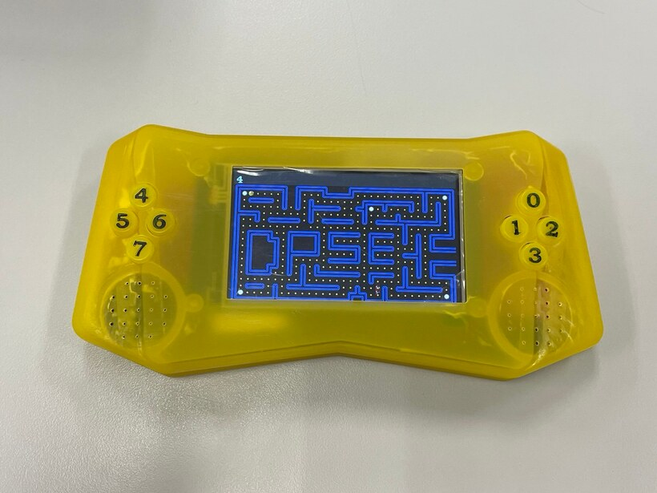
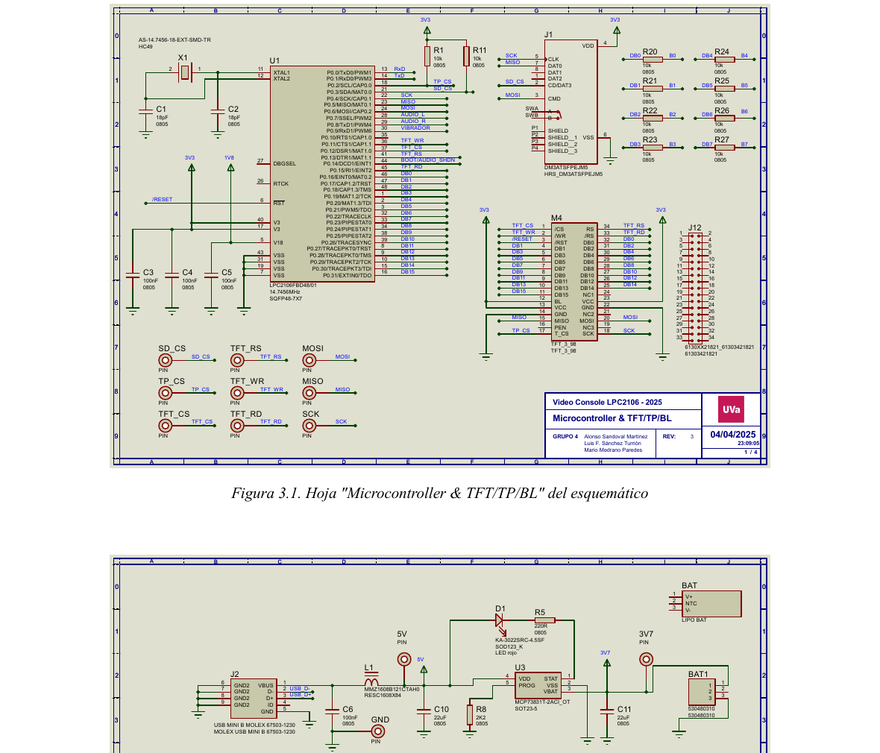
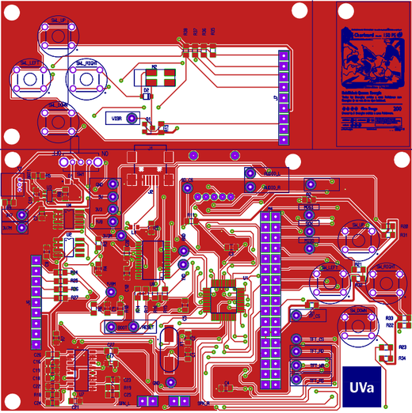
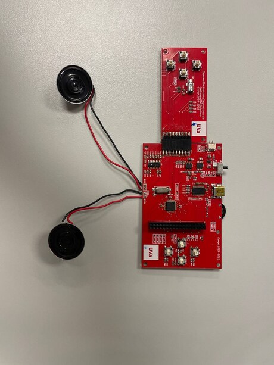

# Handheld retro console on an LPC2106

A battery-powered handheld built from a blank page: schematic, a custom two-layer PCB, bare-metal C firmware and a resin-printed case, running a Pac-Man written for it. ARM7TDMI at 14.7 MHz, 800×480 TFT, two D-pads, stereo audio, haptics.

Electronic product design course, Master's in Telecommunications Engineering, University of Valladolid, 2025. Three of us: Alonso Sandoval, Mario Medrano and Luis F. Sánchez. The hardware was a joint effort; the firmware and the game are mostly mine. Mario keeps his copy at [medpar/Retro-Gaming-Console](https://github.com/medpar/Retro-Gaming-Console).

<p align="center">
  
</p>

## Hardware

| | |
| --- | --- |
| MCU | NXP LPC2106, ARM7TDMI, 14.7456 MHz crystal |
| Display | 800×480 TFT (NT35510) with a resistive touch panel (XPT2046, SPI) |
| Controls | two D-pads, eight tactile buttons multiplexed onto the TFT's 16-bit data bus |
| Audio | PAM8403 class-D stereo amplifier, two speakers, volume pot |
| Haptics | vibration motor on a P-channel MOSFET, driven by a timer |
| Power | 2000 mAh Li-Po, MCP73831 charger, USB Mini-B input, MCP1725 regulators for 3.3 V and 1.8 V with USB/battery source select |
| Programming | CY7C65213 USB-UART bridge into the LPC bootloader |

Every rail and bus has a test point. Current budgets per rail sized the regulators, the input filter and the trace widths; junction temperatures were checked part by part. 116 parts, about €67 in components.

<p align="center">
  
</p>
<p align="center">
  
  
</p>

## Firmware

Bare-metal C with the GNU ARM toolchain, no OS. Developed against a simulation model of the micro first, then flashed. Per-peripheral drivers:

- `NT35510.c`: display init, fills, sprite and text rendering
- `xpt2046.c`, `calibrate.c`: touch readout and calibration
- `audio.c`: four-channel wavetable synth on the PWM peripheral, 57.6 kHz carrier, a timer interrupt stepping the score every ~128 ms; music and effects share the engine
- `vibrador.c`: one-shot haptic pulses on Timer 1, no busy-waiting
- `xpm.c`: XPM sprite loader for the game graphics

## The game

A Pac-Man clone for the platform. 24×24 sprites, a maze that spells "DPSE" in the middle, four ghosts released in sequence with randomised pathfinding, power-ups that flip them vulnerable, lives, score, win and lose. Movement is pixel by pixel between tiles with the background restored behind each sprite, so nothing flickers. The loop reads the buttons, moves everyone, checks collisions and redraws only what changed.

## Layout

```
Hardware/            Proteus project, schematic PDF, BOM, Gerber and mechanical drawings
Software/LPC2106_1/  firmware: drivers, audio engine, the game, linker script, Makefile
Software/bootloader2103/  flashing tools
AnálisisTyE/         electrical and thermal analysis
Planificacion/       Gantt
Control de cambios/  change logs kept through the build
Documentación/       full report (Spanish)
docs/images/         photos used here
```

Tools: Proteus for schematic and layout, PCBWay fabrication, hand SMD soldering, SLA printing for the case, GNU ARM toolchain for the firmware.
